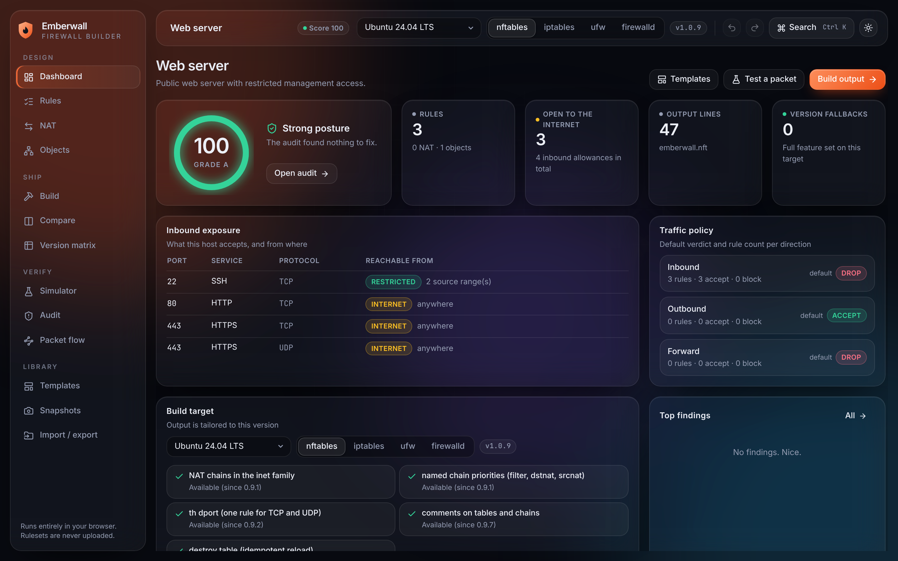
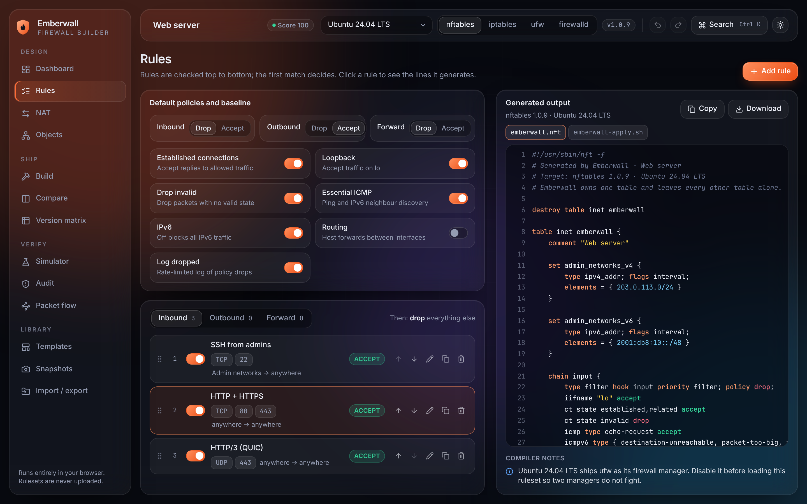
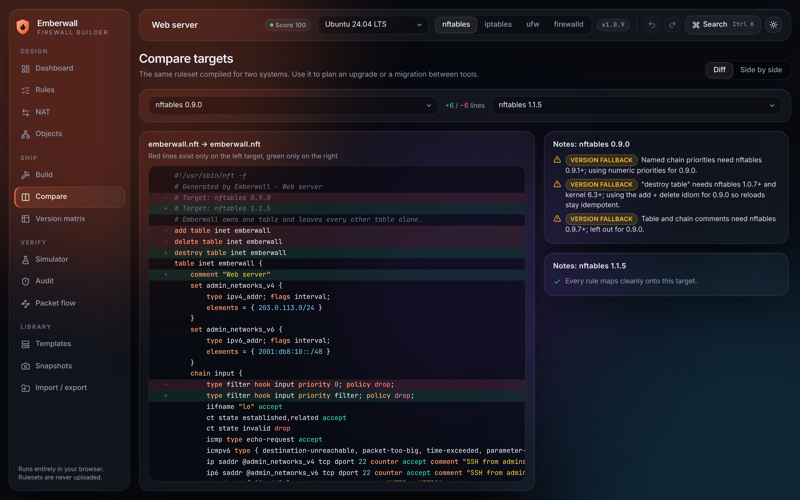

# Emberwall

**Design a Linux firewall once. Compile it for the exact tool and version you run.**

Emberwall is a browser-based firewall builder. You describe the policy in one visual model and it
generates ready-to-apply output for **nftables, iptables, ufw and firewalld**, adapted to the
version on the target system. Everything runs client-side: rulesets are never uploaded.



## Why it is different

Most online generators turn a form into text for one tool. Emberwall keeps a single model and
gives you the tooling around it:

| | |
|---|---|
| **Version-aware output** | Pick a distribution (Ubuntu, Debian, RHEL/Alma/Rocky, Alpine, Arch) or a specific tool version. The compiler uses new syntax where the version has it and a working fallback where it does not, and tells you which. |
| **Four backends, one ruleset** | nftables (`nft -f`), iptables (`iptables-restore`, IPv4 + IPv6), ufw (commands + `before.rules` fragments), firewalld (`firewall-cmd` script + zone XML). |
| **Packet simulator** | Describe a packet and see the verdict plus a step-by-step trace of every check it hit. |
| **Audit** | Finds exposed services, any-any rules, shadowed and redundant rules, lock-out risk, broken DNS, port forwards without a forward rule. One-click fixes and a 0–100 posture score. |
| **Safe apply** | Every build includes a script that backs up the running rules, applies the new ones, and rolls back automatically unless you confirm. The watchdog survives a dropped SSH session. |
| **Compare** | The same ruleset for two targets, as a diff or side by side. Useful when planning an upgrade or a move from iptables to nftables. |
| **Import** | Paste `iptables-save` output and migrate it to any backend. |
| **Line linking** | Click a rule to highlight the lines it produced; click a line to jump to its rule. |
| **Objects** | Reusable address and port groups; nftables output turns address groups into named sets. |
| **NAT** | Masquerade, source NAT and port forwarding, including IPv6. |
| **Snapshots, undo, share links** | Named versions with diff and restore, full undo/redo, and links that carry the project in the URL fragment. |
| **Templates** | Web server, SSH bastion, database, Docker host, Kubernetes node, WireGuard gateway, NAT router, workstation. |



## Version handling

Capabilities are data, not scattered `if` statements: see [`src/core/targets.ts`](src/core/targets.ts).
Each entry names the first version that has the feature, the kernel it needs where relevant, the
fallback Emberwall emits without it, and the upstream commit that introduced it.

| Tool | Feature | Since | Without it |
|---|---|---|---|
| nftables | NAT in the `inet` family | 0.9.1 (kernel 5.2) | separate `ip` / `ip6` NAT tables |
| nftables | named chain priorities | 0.9.1 | numeric priorities |
| nftables | `th dport` (TCP and UDP in one rule) | 0.9.2 | one rule per protocol |
| nftables | comments on tables and chains | 0.9.7 | left out |
| nftables | `destroy table` | 1.0.7 (kernel 6.3) | `add table` + `delete table` |
| iptables | `iptables-restore --wait` | 1.6.2 | restore without lock wait |
| iptables | `--random-fully` | 1.6.0 SNAT, 1.6.2 MASQUERADE | `--random` |
| ufw | `ufw route` | 0.34 | `before.rules` fragment |
| ufw | rule comments | 0.35 | shell comments |
| firewalld | rich-rule priorities | 0.7.0 | warning: firewalld orders rules itself |
| firewalld | policy objects | 0.9.0 | direct interface |

The in-app **Version matrix** page shows the same table per release, plus what each distribution ships.



## Run it

```bash
npm install
npm run dev        # http://localhost:5173
```

```bash
npm test           # unit tests + real-tool checks
npm run build      # type-check and production build into dist/
npm run preview    # serve the production build
```

Requires Node 18+. The production build is a static site (`dist/`) that can be hosted anywhere.

## How the output was checked

- `npm test` compiles every template and an edge-case project for every tool version.
- When `iptables-restore`, `ip6tables-restore` and `nft` are installed, the tests feed the generated
  rulesets to `iptables-restore --test` and `nft -c -f` and require zero errors. They are skipped
  automatically where the binaries are missing or unusable.
- During development the generated ufw commands and firewalld rich rules were also parsed with the
  upstream ufw and firewalld parsers. That check is not part of the automated suite.

Nothing here has been applied to a live production host by the test suite. Use the safe-apply
script, and keep console access the first time you load a ruleset on a remote machine.

## Known limits

- Rate limits are per rule, not per source address (ufw's `limit` is the exception, and its rate is fixed).
- ufw and firewalld cannot express everything: ICMP rules and connection-state matches go to a
  `before.rules` fragment for ufw; firewalld drops per-rule interface and state matches. Each case
  is reported in the compiler notes rather than silently changed.
- The importer reads `iptables-save` only. Negated matches, custom chains and exotic targets are
  listed as skipped.
- Distribution versions are a snapshot; rolling releases move. Pick a custom version if yours differs.

## Project layout

```
src/core/            model, address maths, targets, simulator, audit, importer, diff
src/core/compile/    one compiler per backend + the safe-apply script
src/store/           app state, undo history, snapshots, share links
src/ui/              glass shell, pages and components
tests/               unit tests and real-tool validation
```

## License

MIT
