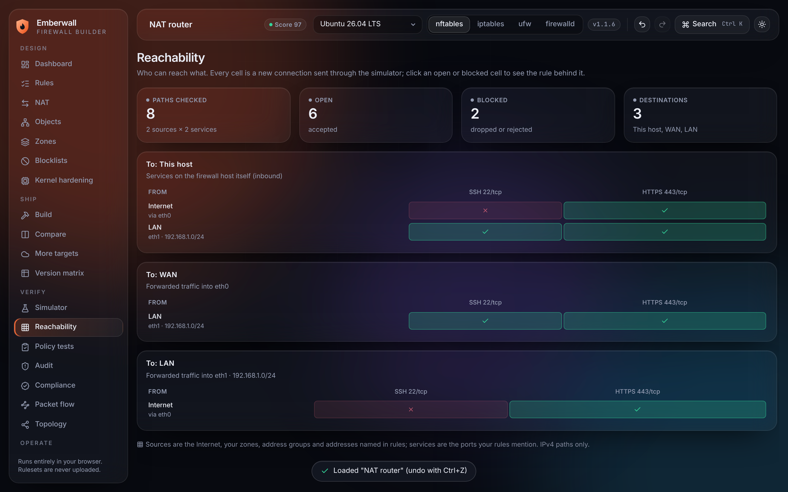
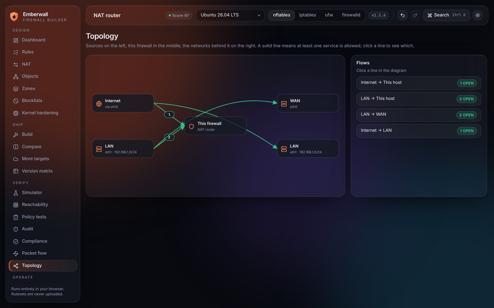

# Emberwall

**Design a Linux firewall once. Compile it for the exact tool and version you run.**

Emberwall is a browser-based firewall builder. You describe the policy in one visual model and it
generates ready-to-apply output for **nftables, iptables, ufw and firewalld**, adapted to the
version on the target system. Everything runs client-side: rulesets are never uploaded.


## Why it is different

Most online generators turn a form into text for one tool. Emberwall keeps a single model and
gives you the tooling around it:

| | |
|---|---|
| **Version-aware output** | Pick a distribution (Ubuntu 20.04–26.04, Debian, RHEL/Alma/Rocky, Alpine, Arch) or a specific tool version. The compiler uses new syntax where the version has it and a working fallback where it does not, and tells you which. |
| **Four backends, one ruleset** | nftables (`nft -f`), iptables (`iptables-restore`, IPv4 + IPv6), ufw (commands + `before.rules` fragments), firewalld (`firewall-cmd` script + zone XML). |
| **Packet simulator** | Describe a packet and see the verdict plus a step-by-step trace of every check it hit. |
| **Audit** | Finds exposed services, any-any rules, shadowed and redundant rules, lock-out risk, broken DNS, port forwards without a forward rule. One-click fixes and a 0–100 posture score. |
| **Safe apply** | Every build includes a script that backs up the running rules, applies the new ones, and rolls back automatically unless you confirm. The watchdog survives a dropped SSH session. |
| **Compare** | The same ruleset for two targets, as a diff or side by side. Useful when planning an upgrade or a move from iptables to nftables. |
| **Import** | Paste `iptables-save`, `nft list ruleset`, ufw commands or status, or a firewalld zone file, and migrate it to any backend. |
| **Zones** | Name WAN, LAN, DMZ, VPN once; write rules "from LAN to WAN". |
| **Reachability matrix** | A who-can-reach-what grid across the Internet, zones, groups and services, computed with the simulator. |
| **Policy tests** | Save packets as assertions ("the database is never public"). They run on every change and fail visibly. |
| **Semantic diff** | Between two snapshots: which access opened or closed, not only which lines changed. |
| **Attack protection** | Per-client rate limits and connection limits, SYN-flood guard, port-scan filter, auto-ban trap ports. |
| **Advanced matches** | Source ports, MAC address, packet mark, weekly schedules. |
| **Blocklists and geo-blocking** | Address sets dropped before everything else; kept in the project or downloaded on the server by a generated updater script and systemd timer. |
| **Kernel hardening** | A sysctl drop-in (reverse-path filter, SYN cookies, redirects, source routing) shipped with every build. |
| **Compliance profiles** | CIS-style, PCI DSS-style and an internet-server baseline, each control with evidence; printable to PDF. |
| **More targets** | pf (OpenBSD and FreeBSD), Windows Firewall (PowerShell), AWS / Azure / Google Cloud security groups (Terraform) and Kubernetes NetworkPolicy, each with a list of what does not carry over. |
| **Fleet** | Many hosts, one policy: shared rules plus host-scoped rules, each host compiled for its own tool and version, with an Ansible inventory and playbook. |
| **Topology** | Diagram of sources, the firewall and the networks behind it, with the allowed flows drawn from the reachability engine. |
| **Log analyzer** | Paste kernel firewall logs: top sources and ports, what the current ruleset would do with them, one-click block or allow. |
| **Assistant (opt-in)** | With your own Anthropic API key: describe a policy in plain English and review proposed rules, or ask questions about the ruleset. Off until you add a key. |
| **CLI** | `emberwall build / fleet / audit / test / compliance` for CI, with exit codes. |
| **Offline app** | Installable; works without a network after the first visit. |
| **Automation export** | Ansible playbook, Terraform (SSH push) and cloud-init user data for every build. |
| **Line linking** | Click a rule to highlight the lines it produced; click a line to jump to its rule. |
| **Objects** | Reusable address and port groups; nftables output turns address groups into named sets. |
| **NAT** | Masquerade, source NAT and port forwarding, including IPv6. |
| **Snapshots, undo, share links** | Named versions with diff and restore, full undo/redo, and links that carry the project in the URL fragment. |
| **Templates** | Web server, SSH bastion, database, Docker host, Kubernetes node, WireGuard gateway, NAT router, workstation. |






## Version handling

Capabilities are data, not scattered `if` statements: see [`src/core/targets.ts`](src/core/targets.ts).
Each entry names the first version that has the feature, the kernel it needs where relevant, the
fallback Emberwall emits without it, and the upstream commit that introduced it.

| Tool | Feature | Since | Without it |
|---|---|---|---|
| nftables | NAT in the `inet` family | 0.9.1 (kernel 5.2) | separate `ip` / `ip6` NAT tables |
| nftables | named chain priorities | 0.9.1 | numeric priorities |
| nftables | `th dport` (TCP and UDP in one rule) | 0.9.2 | one rule per protocol |
| nftables | comments on tables and chains | 0.9.7 | left out |
| nftables | `destroy table` | 1.0.7 (kernel 6.3) | `add table` + `delete table` |
| nftables | `ct count` (connection limits) | 0.9.1 | limit left out, reported |
| nftables | `meta hour` / `meta day` (schedules) | 0.9.3 | schedule left out, reported |
| nftables | sets updated from rules | 0.9.7 | meter syntax; no auto-ban |
| iptables | `iptables-restore --wait` | 1.6.2 | restore without lock wait |
| iptables | `--random-fully` | 1.6.0 SNAT, 1.6.2 MASQUERADE | `--random` |
| ufw | `ufw route` | 0.34 | `before.rules` fragment |
| ufw | rule comments | 0.35 | shell comments |
| firewalld | rich-rule priorities | 0.7.0 | warning: firewalld orders rules itself |
| firewalld | policy objects | 0.9.0 | direct interface |

The in-app **Version matrix** page shows the same table per release, plus what each distribution ships.


## Run it

```bash
git clone https://github.com/cloudlative/emberwall.git
cd emberwall
npm install
npm run dev        # http://localhost:5173
```

```bash
npm test           # unit tests + real-tool checks
npm run build      # type-check and production build into dist/
npm run preview    # serve the production build
```

On first start a short wizard asks what the machine is, what it runs and where you administer it
from, and builds a starting ruleset. Re-run it any time from the command palette (Ctrl+K).

### Command line

The same engine runs outside the browser, for CI:

```bash
npm run cli -- targets
npm run cli -- build project.json --target debian-12:nftables --out out/ --iac
npm run cli -- build project.json --target nftables@1.0.9 --strict   # fail on fallbacks
npm run cli -- test project.json                # policy tests; exit 1 on failure
npm run cli -- audit project.json --min-score 80
npm run cli -- compliance project.json --profile pci --min 90
npm run cli -- fleet project.json --out fleet/
npm run build:cli                               # single-file bundle: dist-cli/emberwall.mjs
```

Project files are the JSON exported from **Import / export**.

### Hosting

`.github/workflows/pages.yml` deploys the site to GitHub Pages on every push to `main`. Enable it
once under repository **Settings → Pages → Source: GitHub Actions**; until then that workflow fails
at its deploy step.

### The assistant and your data

Everything in Emberwall runs in your browser. The one exception is the optional assistant: when you
add your own Anthropic API key and press a button, your request and the project's rules, zones,
groups and NAT settings go from your browser to the Anthropic API. The page shows exactly what is
sent. The key stays in the tab unless you tick "remember". The assistant's API calls have been
type-checked against the official SDK and its output validation is unit-tested, but it has not been
exercised against the live API in this repository's tests.

Requires Node 18+. The production build is a static site (`dist/`) that can be hosted anywhere.

## How the output was checked

- `npm test` compiles every template and an edge-case project for every tool version.
- When `iptables-restore`, `ip6tables-restore` and `nft` are installed, the tests feed the generated
  rulesets to `iptables-restore --test` and `nft -c -f` and require zero errors. They are skipped
  automatically where the binaries are missing or unusable.
- During development the generated ufw commands and firewalld rich rules were also parsed with the
  upstream ufw and firewalld parsers. That check is not part of the automated suite.
- Every generated shell script passes `sh -n`; IPv4 sysctl keys were checked against a running kernel.
- Extra targets: the Terraform output passes `terraform fmt -check` and `terraform validate`
  (aws, azurerm, google providers); the PowerShell passes the PowerShell 7 parser and runs against
  stub cmdlets built from Microsoft's documented syntax; the NetworkPolicy YAML parses. **pf output
  has not been run through `pfctl`** (no pf on Linux), and nothing was applied to a real cloud
  account, Windows host or cluster.
- The fleet playbook and inventory parse; the CLI is covered by tests and its nftables output was
  checked with `nft -c`.
- Offline loading was tested in a browser with the network switched off.
- Importer tests compile each template, import the result and require that no access changes.
- The generated Ansible playbooks pass `ansible-playbook --syntax-check`; the Terraform file has
  not been run through `terraform validate`.

- Emitted syntax was read against the current manual pages: `nft(8)` 1.1.6, `iptables(8)` and
  `iptables-extensions(8)` 1.8.11, `ufw(8)` 0.36.2, and `firewall-cmd(1)`,
  `firewalld.richlanguage(5)`, `firewalld.policy(5)` 2.3.1, plus the firewalld 2.5.2 source tree.

Nothing here has been applied to a live production host by the test suite. Use the safe-apply
script, and keep console access the first time you load a ruleset on a remote machine.

## Known limits

- Per-client rate limits, connection limits, schedules, MAC and mark matches and the attack
  protections are native on nftables and iptables. ufw gets them through a `before.rules` fragment
  (its own `limit` has a fixed rate); firewalld cannot express most of them and says so.
- Zones expand to interface and network matches. On firewalld the interface part is dropped
  (firewalld binds interfaces to its own zones); the compiler notes report it.
- The reachability matrix and semantic diff cover IPv4 paths for the sources and services the
  rules mention; they are a model of the ruleset, not a scan of a live host.
- ufw and firewalld cannot express everything: ICMP rules and connection-state matches go to a
  `before.rules` fragment for ufw; firewalld drops per-rule interface and state matches. Each case
  is reported in the compiler notes rather than silently changed.
- Blocklists on iptables and ufw rely on `ipset`. That syntax could not be run through
  `iptables-restore --test` here (no `ipset` in the test environment); the nftables form was.
  Country lists are downloaded by the server from a third-party site that Emberwall does not check.
- Compliance profiles are Emberwall's reading of each framework's firewall-related intent. They
  support a review; they are not official benchmark content or a certification.
- The extra targets filter differently from Linux: cloud security groups and NetworkPolicy are
  allow-only, Windows has no rule order (block beats allow), pf rate limits ban the client on all
  ports. Each difference is reported next to the output. Treat pf output as unverified until you
  run `pfctl -nf` on it.
- Fleet hosts share objects, zones and options; only rules and the target differ per host.
- Importers cover the common rule shapes. Negated matches, custom chains, jumps, firewalld
  services outside a built-in list and other unusual constructs are listed as skipped, not guessed.
- Distribution versions are a snapshot; rolling releases move. Pick a custom version if yours differs.

## Project layout

```
src/core/            model, targets, simulator, audit, reachability, compliance, fleet, logs, assistant
src/core/compile/    one compiler per backend, blocklists, automation export, safe-apply script
src/core/compile/extra/  pf, Windows, cloud security groups, Kubernetes
src/core/import/     iptables-save, nft, ufw and firewalld importers
cli/                 command-line entry point
src/store/           app state, undo history, snapshots, share links
src/ui/              glass shell, pages and components
tests/               unit tests and real-tool validation
```

## License

MIT
